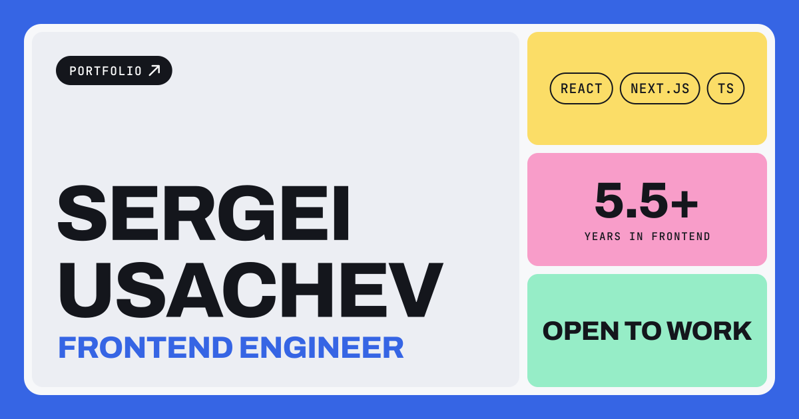

<a href="https://personal-site-ashen-one.vercel.app">
  
</a>

<h1 align="center">Sergei Usachev — personal site</h1>

<p align="center">
  A one-screen bento portfolio with two moods: <b>Casual</b> and <b>Formal</b>.
</p>

<p align="center">
  <a href="https://personal-site-ashen-one.vercel.app"><b>Live site</b></a> ·
  <a href="https://personal-site-ashen-one.vercel.app/sergei-usachev-cv.pdf">Resume</a> ·
  <a href="https://www.linkedin.com/in/sergeiusachev/">LinkedIn</a> ·
  <a href="mailto:usachev.frontend@gmail.com">Email</a>
</p>

<p align="center">
  
  
  
  
</p>

---

## What's inside

- **Bento grid on a single screen.** Photo, about, work, contacts, approach and stack. Each tile expands into its own section without leaving the page.
- **Two modes.** *Casual* puts pastel tiles edge to edge and adds playful GSAP effects. *Formal* is calm and spaced out: the tile you hover stays in focus and the rest fade. The choice is saved in `localStorage`.
- **Project previews.** Short screen recordings of real sites with posters, plus design cases for internal tools.
- **Fast by default.** Static output, inlined CSS, AVIF/WebP portraits with responsive sizes. GSAP loads as a separate chunk, only when an effect needs it.
- **Respects the user.** `prefers-reduced-motion` and touch screens turn the fun effects off, everything works from the keyboard, and analytics are cookie-free.

## Stack

| | |
|---|---|
| Framework | [Astro](https://astro.build) — static build, zero JS by default |
| Language | TypeScript |
| Animation | [GSAP](https://gsap.com) with SplitText and Draggable |
| Fonts | Archivo, JetBrains Mono via Fontsource |
| SEO | `@astrojs/sitemap`, Open Graph image, `robots.txt` |
| Hosting | Vercel + Vercel Web Analytics |

## Getting started

Needs Node.js 22.12 or newer.

```bash
npm install
```

```bash
npm run dev
```

The site runs at `http://localhost:4321`.

| Command | What it does |
|---|---|
| `npm run dev` | Start the dev server |
| `npm run build` | Build the static site into `dist/` |
| `npm run preview` | Serve the built site locally |

## Project structure

```text
src/
├── content.ts        # all texts, links, projects, stack: edit content here
├── pages/            # index and 404
├── layouts/          # <head>, meta tags, analytics, saved mode
├── components/       # one component per tile, plus shared bits
├── scripts/          # client-side effects (hover, shuffle, likes, copy email)
├── styles/global.css # design tokens for both modes
└── assets/           # photos and project screenshots (optimized at build)
public/               # resume PDF, project videos, OG image, favicons
```

## Updating content

Almost everything lives in [`src/content.ts`](src/content.ts):

- **Links** — `links` (contacts tile, resume and email buttons)
- **Projects** — `projects`; add `video` for a screen recording from `public/video`, or `image` for a screenshot
- **Experience, hobbies, photos** — `about`
- **Resume** — replace `public/sergei-usachev-cv.pdf` and keep the name, so links stay the same

The site URL is set in [`astro.config.mjs`](astro.config.mjs). When it changes, update `public/robots.txt` as well.

---

<p align="center">
  Built by <a href="https://github.com/iamlykke">Sergei Usachev</a> in Serbia 🇷🇸
</p>
